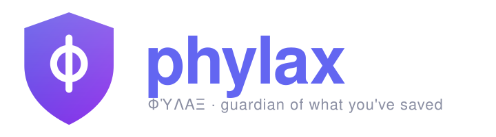
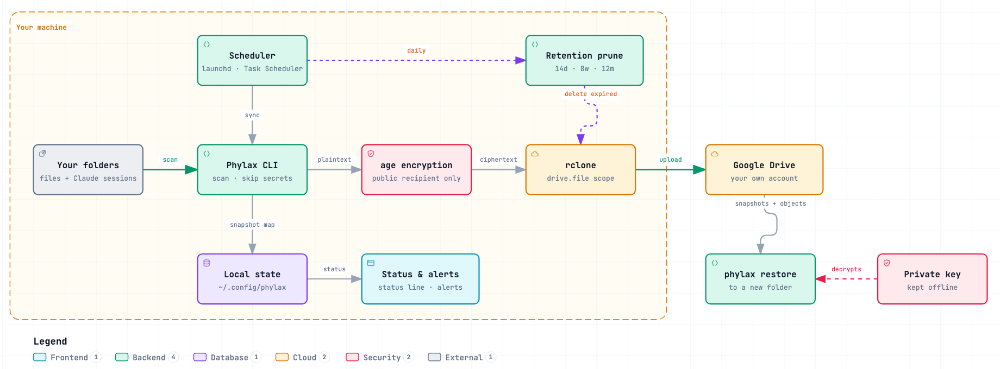

<h1 align="center"></h1>

<p align="center"><em>Phylax (Φύλαξ) — Greek for “guardian”: it keeps watch over what you've saved.</em></p>

<p align="center">
  <a href="https://github.com/agentnetes/phylax/actions/workflows/ci.yml"></a>
  <a href="https://github.com/agentnetes/phylax/releases/latest"></a>
  <a href="LICENSE"></a>
  
  
  
  
  <a href="https://github.com/agentnetes/phylax/commits/main"></a>
</p>

Encrypted, scheduled backup of your **Claude Code context** and **project folders** to **your own Google Drive**.
A laptop restart, wipe or loss no longer means losing your sessions, notes or files. macOS and Windows.

- **Private by design** — everything is encrypted on your machine with [age](https://age-encryption.org) before it leaves. Your private key never goes to Drive.
- **Your Drive, your key** — each person uses their own Google account and key. Nothing is shared between users.
- **Files stay local** — Phylax copies *to* Drive; it never syncs back over your files.
- **Versioned** — point-in-time snapshots with daily/weekly/monthly retention, so deletions and bad edits can be undone.
- **Hands-off** — runs in the background every 30 minutes and alerts you if a backup fails.

## Install

| Platform | Command |
|---|---|
| macOS | `curl -fsSL https://github.com/agentnetes/phylax/releases/latest/download/bootstrap.sh \| bash` |
| Windows (PowerShell) | `irm https://github.com/agentnetes/phylax/releases/latest/download/bootstrap.ps1 \| iex` |
| Homebrew | `brew tap agentnetes/phylax https://github.com/agentnetes/phylax && brew trust agentnetes/phylax && brew install phylax` |
| Scoop | `scoop bucket add phylax https://github.com/agentnetes/phylax` then `scoop install phylax` |

Each route ends with `phylax setup`, a guided installer that connects Google Drive, creates your encryption key,
installs the background schedule and (optionally) a Claude Code status-line indicator.
Newer Homebrew versions refuse third-party taps until you run `brew trust` (as shown above). The one-liners verify a SHA-256 checksum before installing. Prefer to read first? Download `bootstrap.sh` / `bootstrap.ps1` and run it yourself.

> **Save your private key.** Setup creates it on your machine; move it into your password manager and delete the local copy.
> Without it, encrypted backups cannot be restored. Add an IT recovery key with `phylax add-recipient age1…`.

**Let Claude do it:** clone this repo, run `claude` in it and say *"set me up"* — see [CLAUDE.md](CLAUDE.md).

## What gets backed up

Choose a mode per project folder:

| Mode | Uploaded to Drive |
|---|---|
| `context` (default) | `CLAUDE.md`, a file manifest and session index (readable), plus your Claude sessions **encrypted** |
| `full` | **Every file encrypted** under opaque names with an encrypted index — not even file names are readable |
| `both` | `full` plus encrypted Claude sessions |

Claude memory (`~/.claude/projects/<home>/memory`) and `~/.claude/CLAUDE.md` are backed up once, encrypted, for the whole machine.

## Architecture

<picture>
  <source media="(prefers-color-scheme: dark)" srcset="docs/architecture-dark.png">
  
</picture>

- **Everything is encrypted before upload.** The machine holds only the *public* age recipient, so it can write backups but never read them.
- **Drive layout, `context` mode:** readable `CLAUDE.md`, `manifest.json`, `sessions-index.json`, plus `encrypted/<project>--claude-backup-<ts>.tar.gz.age`.
- **Drive layout, `full` mode:** `files/objects/<sha>.age` (one encrypted object per unique content) and `files/snapshots/<ts>.json.age` (encrypted index per change) — names and contents are unreadable.
- **Local state** (`~/.config/phylax`, Windows `%APPDATA%\phylax`) keeps the snapshot map and sync history; it drives the status line and failure alerts.
- **Restore** needs your private key (kept offline), decrypts a snapshot, fetches only the objects it lists and writes them to a *new* folder.

Open [`docs/architecture.html`](docs/architecture.html) locally for the interactive version (pan, zoom, trace); its source is [`docs/architecture.json`](docs/architecture.json).

## Usage

```bash
phylax menu                                  # interactive menu (gum)
phylax init --name board --dir ~/Documents/Board --mode full --exclude "Personal/*"
phylax projects                              # list projects
phylax sync [-p NAME] [--dry-run]            # sync now (all projects by default)
phylax status [-p NAME]                      # dashboard;  phylax watch  for a live view
phylax doctor                                # health check with fixes
```

- **Many folders at once:** menu → *Add folders in bulk*, or `phylax discover PARENT`.
- **Existing folders are safe:** originals are never modified; secret-looking files (`*.pem`, `.env*`, `*.tfstate`, …) are never listed in the readable manifest; `node_modules`, `.venv` and similar are skipped.
- **Git backup (optional):** `phylax git-init -p NAME` creates a **private** repo on *your* GitHub account and auto-pushes. It refuses folders that already have a remote unless you pass `--use-existing-remote`, and never auto-commits secret-looking files.
- **Large uploads:** full mode skips files over 200 MB (`--max-file-mb`) and asks for one-time approval (`--yes`) before a first upload over 2 GB. Preview with `--dry-run`.

## Versioning, retention and restore

Every change produces an encrypted snapshot. File contents are stored once by hash, so unchanged and duplicate files cost nothing.
Default retention keeps the newest snapshot per day for 14 days, per week for 8 weeks and per month for 12 months
(`--keep-daily/--keep-weekly/--keep-monthly`). It runs daily; run it manually with `phylax prune [--dry-run]`.

```bash
phylax restore-files -p board --identity key.txt --snapshots          # list restore points
phylax restore-files -p board --identity key.txt --at 2026-11-10 --match "budget" --to ~/Restored
phylax restore -p board --identity key.txt                            # restore Claude sessions
```

Restores never write over the original folder unless you pass `--force`. On a new machine: install, run `phylax setup`
(use the same Google account), then restore with your saved key.

## Security model

- Encryption: age, to one or more **public** recipients. The machine holding the backups can write but not read them.
- Drive access: rclone with the `drive.file` scope — Phylax can only see files it created.
- Tokens: the Google login is stored by rclone in its own config on your machine; the installer never prints it.
- Readable metadata: only in `context` mode (file paths, sizes, hashes of non-secret files). Use `full`/`both` if names are sensitive.
- Duplicate files are visible as identical hashed objects (content is not).
- Deleted objects move to Drive's trash (auto-emptied after 30 days).
- The one-liners run code from this repository: protect the maintainers' accounts with 2FA.

## Status

macOS: tested. **Windows scripts are written but not yet tested on a Windows machine** — please report issues.
Not built: restore wizard in the menu, off-machine "no backup for 24 h" alerts (alerts only fire when the job runs).

## Troubleshooting

- `phylax doctor` first — it checks tools, Drive login, key, schedule and disk space.
- Auth errors from Google: rclone's shared client ID is being retired in 2026. Create your own OAuth client
  (Google Cloud Console → Drive API → OAuth client "Desktop") and run `rclone config update <remote> client_id=… client_secret=…`.
- macOS log: `~/.config/phylax/sync.log`.

## Uninstall

`phylax schedule remove`, then delete `~/.phylax` (or `brew uninstall phylax` / `scoop uninstall phylax`), `~/.config/phylax`
(Windows: `%APPDATA%\phylax`) and the rclone remote (`rclone config delete gdrive-phylax`). Drive data is yours to delete.

## Development

Python 3.10+, standard library only; external tools: `rclone`, `age`, `gum`, `git`.
`tests/smoke.sh` runs an end-to-end test against a local folder (no Google account needed).
`scripts/release.sh VERSION agentnetes/phylax` builds the release assets into `dist/` and writes `Formula/phylax.rb` and `bucket/phylax.json` (commit those after uploading the release — they carry the asset hashes).

## License

Source-available under the [Functional Source License, Version 1.1, ALv2 Future License](LICENSE) (FSL-1.1-ALv2), © 2026 Agentnetes.
You may use, copy, modify and redistribute Phylax for any purpose except a **Competing Use** (offering it as a competing commercial product or service);
internal use, education, research and professional services are explicitly permitted. Each release automatically becomes available under
Apache-2.0 on its second anniversary. FSL is source-available, not OSI-approved open source. The licence includes a patent licence for permitted use
but does not itself register or guarantee any patent.
